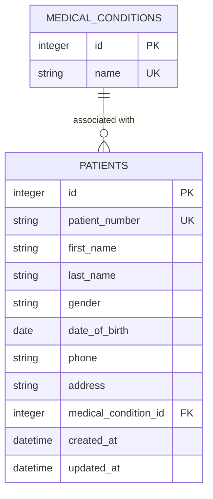

# Patient Management System

Patient management coursework app built with React, Vite, and a Node.js/SQLite API.

## Run locally

```sh
npm install
```

In separate terminals, start the API and frontend:

```sh
npm run server
npm run dev
```

The API uses the built-in `node:sqlite` module (Node.js 22.5 or later) and creates `server/pms.sqlite` automatically. It seeds the sample patient records only when the database is empty. The old root-level `db.json` is not used by the API. Set `PORT` or `DATABASE_PATH` to override the defaults. If the API uses a non-default port, set `VITE_API_TARGET` to its URL before starting Vite (for example, `VITE_API_TARGET=http://localhost:3002 npm run dev`). The legacy `npm run mock-api` command remains as an alias for `npm run server`.

The frontend calls `/api/patients`, which Vite proxies to the API on port 3001. The API supports `GET /patients`, `POST /patients`, `PUT /patients/:id`, `DELETE /patients/:id`, and `GET /health`. The Home, About, Contact, Login, and Patients pages use hash navigation. Login is a UI placeholder and does not authenticate users.

## Database design

The SQL schema is in `server/schema.sql`; sample rows are in `server/seed.sql`.

| Entity | Attributes |
| --- | --- |
| `patients` | `id` (primary key), `patient_number` (unique), `first_name`, `last_name`, `gender`, `date_of_birth`, `phone`, `address`, `medical_condition_id` (foreign key), `created_at`, `updated_at` |
| `medical_conditions` | `id` (primary key), `name` (unique) |

Each patient has zero or one medical condition; a condition may be associated with multiple patients. The API joins the condition name and exposes it as the frontend's `medicalCondition` field.



## Project structure

```text
server/
├── index.js
├── schema.sql
└── seed.sql
public/
└── images/
    └── hospital.jpg
src/
├── assets/
│   └── logo.svg
├── components/
│   ├── Navbar.jsx
│   ├── Footer.jsx
│   ├── PageHeader.jsx
│   ├── PatientForm.jsx
│   ├── PatientTable.jsx
│   └── DeleteConfirmation.jsx
├── pages/
│   ├── Home.jsx
│   ├── About.jsx
│   ├── Contact.jsx
│   ├── Login.jsx
│   └── Patients.jsx
├── services/
│   └── patientService.js
├── styles/
│   ├── index.css
│   ├── navbar.css
│   ├── footer.css
│   ├── pages.css
│   └── patients.css
├── App.jsx
└── main.jsx
```

Run `npm run lint` and `npm run build` to validate the app.
